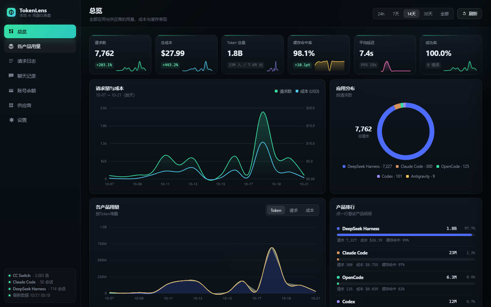
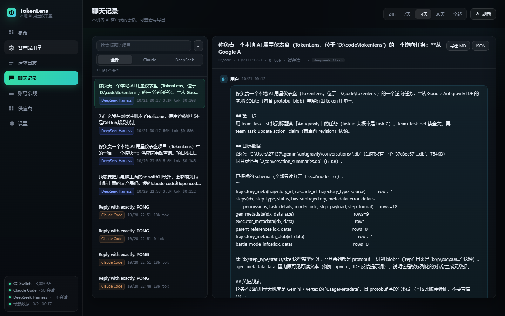
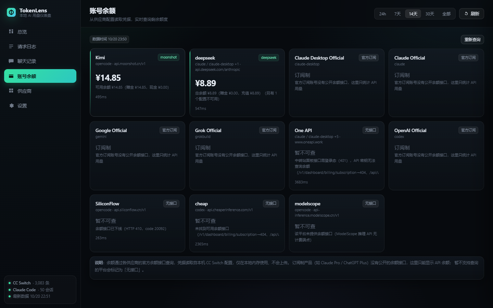
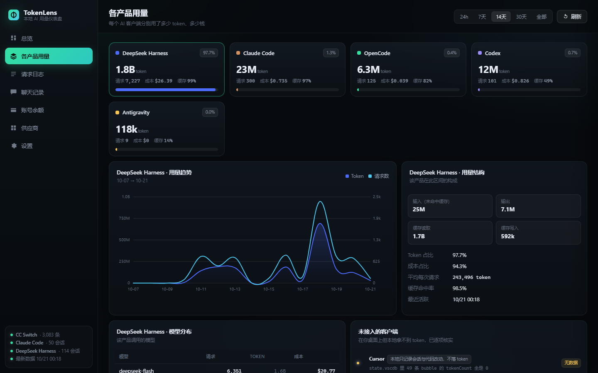

# TokenLens · AI 用量仪表盘

一个看你自己 AI 用量与花费的看板：**Helicone 风格的图表 + 本机聊天记录 + 供应商余额**。

最初是为「本机装的各个 AI 客户端到底花了多少钱、缓存命中怎么样、哪个模型最贵」
做的桌面应用，现在数据层做成了**可插拔**的——同一套界面既能读本机文件，
也能接云端数据库。

- 不联网上报、不需要注册、不需要 API key
- 数据层与分析**零第三方依赖**（Python 标准库 + 原生 JS）
- **只读**：不改你的 `~/.claude`、`~/.dsh`、`~/.gemini`、`~/.cc-switch` 里的任何东西
- 已接入 **5 个客户端**：DeepSeek Harness、Claude Code、Codex、OpenCode、Antigravity



| 聊天记录（含思考 / 工具调用） | 账号余额 |
|---|---|
|  |  |

---

## 30 秒看到效果（不需要装任何客户端）

```bash
git clone https://github.com/w54849768-blip/tokenlens.git
cd tokenlens
python backend/server.py --demo     # Python 3.9+，无需 pip install
# 打开 http://127.0.0.1:8787
```

`--demo` 用的是内置的**合成数据**，界面上每一个数字、每一张图都能看到，
方便先判断「这个仪表盘是不是我想要的」，再接真实数据。

> 截图里的数值来自作者本机真实数据；仓库里**不含任何个人数据**。

---

## 两种用法

### 用法一：本机用量看板（原用途）

```bash
python app.py                 # 独立桌面窗口（WebView2）；没装 pywebview 会自动回退浏览器
start.bat                     # 或者用浏览器打开
```

数据从这些地方只读读取：

| 数据源 | 位置 | 读到什么 |
|---|---|---|
| CC Switch 代理日志 | `~/.cc-switch/cc-switch.db` → `proxy_request_logs` | 逐请求的 token、缓存读写、成本、延迟、状态码 |
| CC Switch 价格表 | 同库 `model_pricing` | 模型单价，给本地日志补算成本 |
| Claude Code 会话 | `~/.claude/projects/**/*.jsonl` | 完整对话 + 每条消息的 usage |
| DeepSeek Harness 会话流 | `~/.dsh/sessions/**/session.v4.jsonl.zstd` | 每条助手消息的 usage，zstd 流式解压、按文件增量解析 |
| Antigravity 会话库 | `~/.gemini/antigravity/conversations/*.db` | protobuf 里的 usage（与它自己的 transcript 逐条比对一致） |

### 用法二：云端仪表盘的基础（给 agent / 团队借鉴）

数据层已经和路由解耦了：

```python
# backend/server.py 只认这个接口，不认识「本机」
server.setup(SOURCE)      # local / demo / 你自己的云端实现
```

想接 Postgres、ClickHouse、对象存储，**只需要新写一个数据源模块**，
`web/` 那一整套界面、图表、导出、会话还原全部照常工作。

👉 **迁移指南：[docs/CLOUD.md](docs/CLOUD.md)** —— 领域模型、接口契约、
可直接复用与必须重写的边界、云端专属的坑（时区、多租户、缓存、采集）。

---

## 功能

**总览**
- 6 个核心指标：请求数、总成本、Token 总量、**缓存命中率**、平均延迟（含 P95）、成功率
- 每张卡片带迷你趋势线和环比（对比上一个等长周期）
- 请求量与成本双轴面积图、Token 构成堆叠图（输入/输出/缓存读）、延迟分布、应用环形图
- **各产品用量**：按 Token / 请求 / 成本切换的堆叠图 + 产品排行
- 模型 Top 榜、供应商/来源榜（点模型直接跳到该模型的请求明细）

**各产品用量**
- 每个 AI 客户端一张卡：token 总量、请求数、成本、缓存命中率、占比
- 点卡片看该产品的用量趋势、用量结构、模型分布
- 「未接入的客户端」逐项列出**为什么没有数据**，不含糊

**请求日志**
- 逐请求明细：时间、应用、模型、来源、输入、输出、缓存读、成本、延迟、状态码
- 按应用 / 模型 / 状态 / 关键词筛选，分页
- 点任意行 → 右侧抽屉看完整 Token 明细、成本拆分、请求 ID
- 一键导出 CSV（带 BOM，Excel 打开中文不乱码）

**聊天记录**
- 同时读多个客户端的会话，可按来源筛选
- 完整还原对话：用户消息、助手回复（Markdown）、💭 思考过程、
  🔧 工具调用与结果（可展开）、图片占位
- 每条助手消息标注本次的输入/输出/缓存读取量
- 单个会话导出 Markdown / JSON，或一键导出全部会话为 zip

**账号余额**
- 从 CC Switch 的供应商配置里读凭据，直连各平台余额接口
- 已适配：DeepSeek、Moonshot/Kimi、SiliconFlow、OpenRouter 等
- 凭据只在本地内存使用，绝不外发、不写入日志、绝不返回给前端



---

## 目录结构

```
tokenlens/
├─ app.py                 桌面应用入口（WebView2 原生窗口）
├─ entrypoint.py          容器入口
├─ start.bat              浏览器模式启动（备用）
├─ backend/
│  ├─ server.py           HTTP 服务：只做路由 + 静态资源，数据源可插拔
│  ├─ source_local.py     数据源：本机文件（默认）
│  ├─ source_demo.py      数据源：内置示例数据（--demo，也是云端实现的模板）
│  ├─ sources.py          本机数据层：CC Switch / Claude Code / DS Harness 解析与聚合
│  ├─ antigravity.py      Antigravity protobuf 用量解析（逆向）
│  └─ balances.py         供应商余额适配器
├─ web/                   index.html + 原生 JS + 手写 SVG 图表库
├─ tools/
│  ├─ smoke_test.py       7 个 API 端点全量自检（CI 也跑这个）
│  └─ make_icon.py        从源图生成多尺寸图标
├─ docs/
│  ├─ CLOUD.md            ★ 云端迁移指南（给借鉴者看的）
│  ├─ API.md              接口契约
│  ├─ DOCKER.md           容器化部署
│  └─ *-probe.md          数据源逆向研究报告
├─ Dockerfile
└─ data/                  运行时生成（不入库）
```

---

## 为什么还需要「原生解析」

实测 CC Switch 的日志会滞后（它只在启动/切换时同步会话），而各客户端自己的
会话文件是实时写入的。所以本应用对 **CC Switch 尚未收录的会话** 直接解析本地原始数据补上用量，
并按会话去重——同一个会话不会同时被两边重复计数。请求列表的「来源」一列会写明
来自 `Claude Code 会话日志` / `DeepSeek Harness 本地记录` / `Antigravity 本地记录`。

**去重规则是踩过坑才定下来的，云端多采集链路并存时同样适用**，详见 docs/CLOUD.md 第 2 节。

---

## 覆盖范围（诚实说明）

| 客户端 | 状态 | 说明 |
|---|---|---|
| **DeepSeek Harness** | ✅ 用量 + 聊天 | zstd 会话流原生解析 |
| **Claude Code** | ✅ 用量 + 聊天 | CC Switch 日志 + `~/.claude` 原生解析 |
| **Codex** | ✅ 用量 | 只统计被 CC Switch 记录的部分 |
| **OpenCode** | ✅ 用量 | 同上 |
| **Antigravity** | ✅ 用量 | protobuf 逆向成功，经 transcript 逐条核对 |
| Cursor | ❌ | 本地 `state.vscdb` 里的 bubble `tokenCount` **全是 0**，只记会话与代码改动 |
| Grok Bot | ❌ | `~/.grokbot` 只有配置与进程启动日志 |
| WorkBuddy AI | ❌ | `workbuddy.db` 的 `session_usage` / `sessions` 表都是 0 行 |
| CodeBuddy / 豆包 | ❌ | 只有内存监控日志 / `public_config.json` |
| ChatGPT、Claude 桌面端 | ❌ | 无本地会话库，要拿到用量必须走代理拦截 |
| 订阅额度（Pro / Plus） | ❌ | 没有公开余额接口；余额页显示的是 **API 余额**，不是订阅剩余额度 |

后面这些**不是漏了，是本地确实没有数据**——界面上也会逐项写明原因。
想把 Cursor / 桌面端也统计进来，正解是给它配一个本地代理，这也是 Helicone 原本的工作方式。

---

## 自检

```bash
python tools/smoke_test.py            # 示例数据，零依赖，CI 跑这个
python tools/smoke_test.py --local    # 用你本机真实数据跑一遍
```

15 项检查，包含：7 个端点结构、筛选/排序、CSV BOM、zip 导出、
以及**「余额/供应商接口不得泄漏凭据」的安全断言**。

## 容器化

```bash
docker build -t tokenlens .
docker run --rm -p 8787:8787 tokenlens      # 示例数据
```

接真实数据的方式与安全注意事项见 [docs/DOCKER.md](docs/DOCKER.md)。

---

## 隐私

- 服务默认只绑定 `127.0.0.1`，局域网内其它设备访问不到
- 所有数据在本机读取与渲染，没有任何上报
- 唯一的外网请求是「余额查询」，用的是你已配置在各平台的密钥直连官方接口
- 导出的文件由你决定放在哪

## 常见问题

**端口被占用？** 会自动顺延到 8787–8798；也可以在「设置」里改。

**数据看着是旧的？** 看「设置 → 数据来源」里的 `CC Switch 滞后 N 天`。

**聊天记录里没有今天的新会话？** 点右上角「刷新」。

**能卸载干净吗？** 直接删掉整个文件夹即可，不写注册表、不留系统服务。

## 后续可以做

- 代理模式（自己起一个 LLM 代理，把 Cursor / 桌面客户端也纳入统计）
- 按项目 / 会话的成本归因
- 每日预算与告警
- 历史数据落库（现在依赖 CC Switch 的留存期）
- 直接给出一个 Postgres 版的数据源实现

## License

MIT
